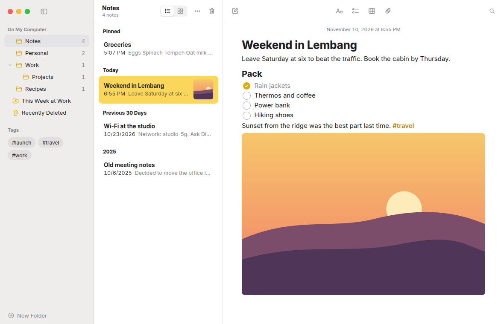
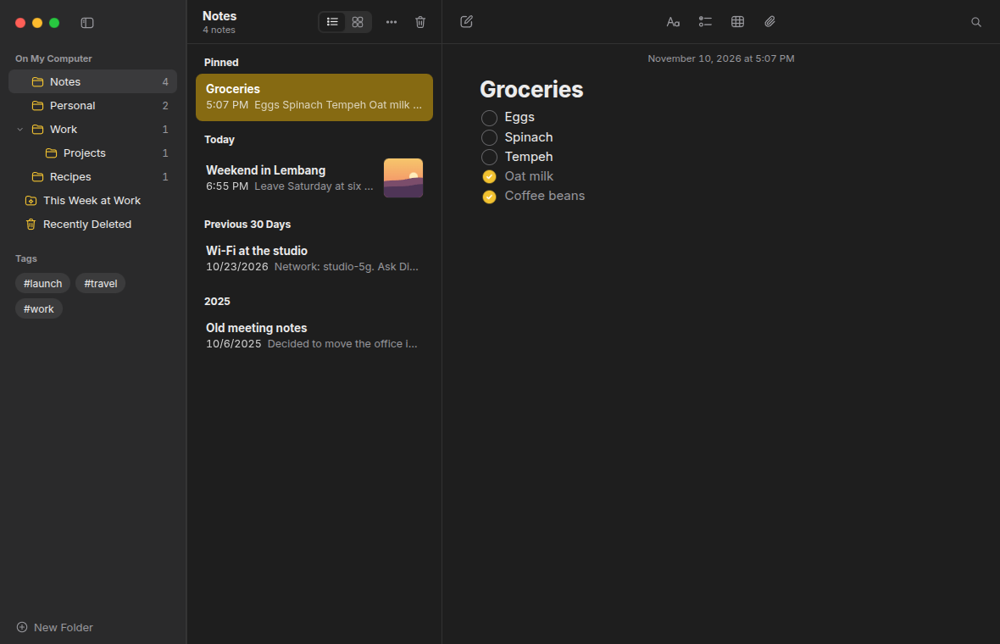

# Renotes

A notes app for Linux with the calm, familiar feel of Notes on the Mac.
Three panes, folders, checklists, tables, pictures and tags, saved as you type
and reopened exactly where you left off. Everything stays on your computer:
no account, no cloud, no telemetry.





## What it does

- **Folders** in a tree, with counts, drag and drop, and inline rename.
- **Notes** that save as you type. The first line is the title. Pin the ones
  you need often; they stay on top.
- **Checklists** with round checkboxes. Checked items sink below the open
  ones.
- **Text styles** as on the Mac: Title, Heading, Subheading, Body, Monostyled,
  bulleted, dashed and numbered lists, block quotes, and tables.
- **Pictures and files**: paste or drop them into a note. Files are kept once,
  however many notes use them.
- **Tags**: type `#travel` anywhere in a note. Tags show in the sidebar; pick
  one or more to filter.
- **Smart folders** that gather notes by tags, dates, checklists, attachments
  or pinned state.
- **Search** across every note, with Top Hits and the matches highlighted.
- **Gallery view**, **Recently Deleted** (kept for 30 days), light and dark
  themes that follow the system.

### Keyboard

| Keys | Action |
| --- | --- |
| Ctrl+N | New note |
| Ctrl+Shift+N | New folder |
| Ctrl+F / Ctrl+Alt+F | Search all notes / find in this note |
| Ctrl+1 / Ctrl+2 | List / gallery |
| Ctrl+Alt+S | Show or hide the sidebar |
| Ctrl+Shift+T, H, J, B | Title, heading, subheading, body |
| Ctrl+Shift+M | Monostyled |
| Ctrl+Shift+L | Checklist |
| Ctrl+Shift+U | Mark a checklist item as done |
| Ctrl+Shift+7, 8, 9 | Bulleted, dashed, numbered list |
| Ctrl+Alt+T | Table |

## Install

Download the `.deb` from the
[latest release](https://github.com/MasRama/ren-notes/releases/latest) and
install it:

```sh
sudo apt install ./Renotes_*_amd64.deb
```

It is built on Ubuntu 24.04 and needs WebKitGTK 4.1, which apt pulls in.
Renotes is tested on GNOME 46 (Wayland) first.

If you used the first Renotes prototype, its notes come over on first start.
Its library is only read, never changed.

## Your data

The library lives in `~/.local/share/ren-notes/` (or under `$XDG_DATA_HOME`):
one SQLite file plus the attachments and thumbnails. Back up that folder to
keep everything.

## Build from source

Renotes is a [Tauri 2](https://tauri.app) app: a Rust core and a Vue page.
[CONTRIBUTING.md](CONTRIBUTING.md) lists what you need.

```sh
cargo test --workspace
cd app
npm ci
npm run tauri dev
```

## How it is built

[ARCHITECTURE.md](ARCHITECTURE.md) describes the parts and the rules they
follow. Read it before changing the code.

## Licence

GPL-3.0-or-later. Renotes is not affiliated with Apple.
